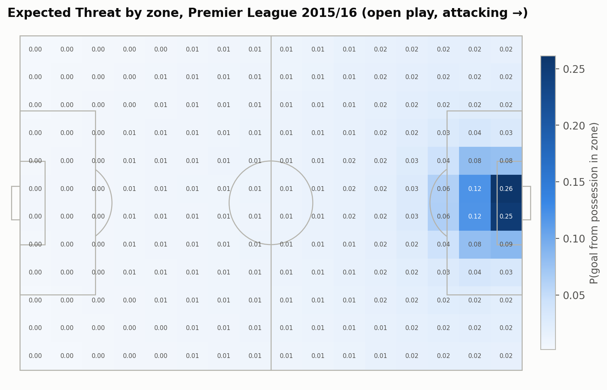
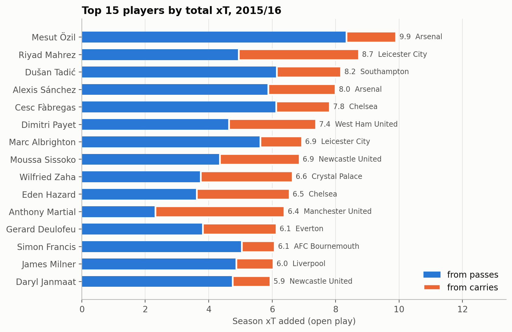
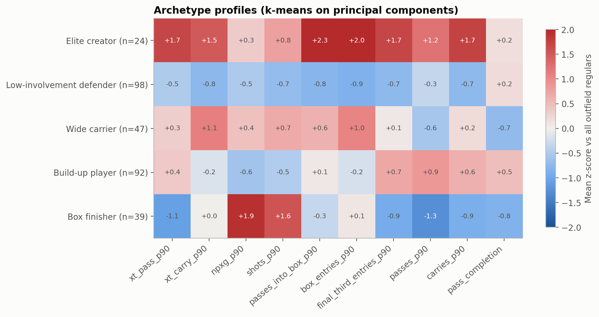
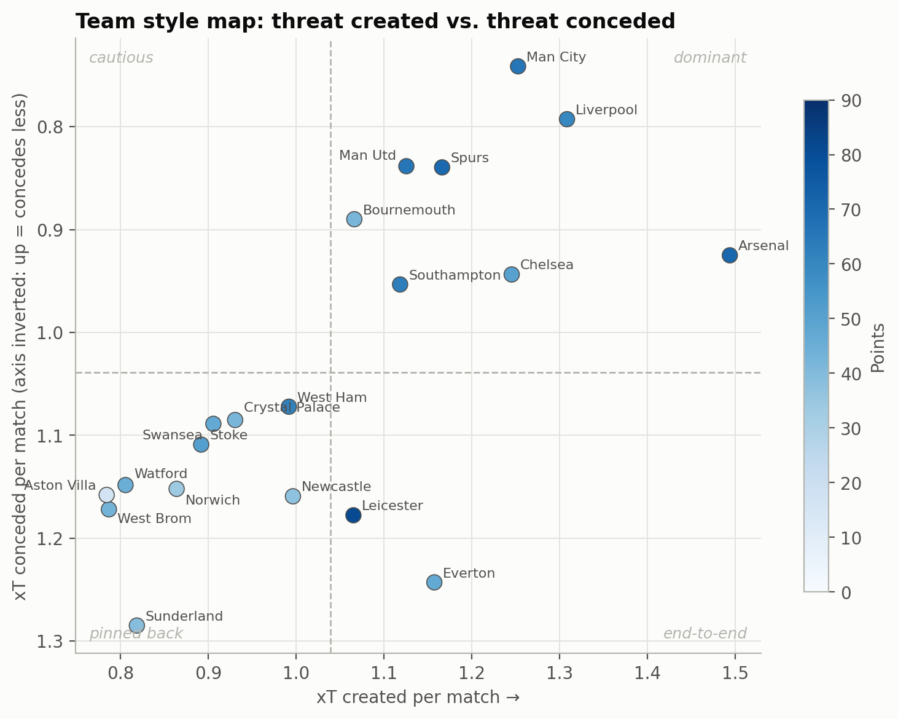

# Expected Threat in the 2015/16 Premier League

**How much does moving the ball forward actually matter?** This project builds an Expected Threat (xT) model from scratch on StatsBomb's event data for the full 2015/16 Premier League season (380 matches, 655k passes, carries and shots). It then uses xT to profile players, explain the league table and test whether ball progression tells us anything about results that shot quality (xG) does not.



## Key findings

**1. The model rates the right players.** With no tuning towards known names, the league's top xT creators are Mesut Özil (19 assists that season), Riyad Mahrez (PFA Player of the Year), Dušan Tadić, Alexis Sánchez and Cesc Fàbregas. xT also separates *how* they create: Özil almost entirely by passing, Mahrez and Anthony Martial largely by carrying.



**2. Creating threat and finishing chances are different skills.** Among the 300 outfield players with 900+ minutes, xT per 90 and non-penalty xG per 90 are essentially uncorrelated (r = −0.02). PCA and k-means on ten per-90 metrics find five archetypes: *elite creators*, *wide carriers*, *box finishers*, *build-up players* and *low-involvement defenders*. A KNN classifier recovers a player's position (DEF/MID/FWD) from the same profile 79% of the time, against a 40% baseline.



**3. Chance quality explains the table; territory does not.** In leave-one-out cross-validation, a team's npxG difference predicts its final points to within about 6 (R² 0.70). xT difference is much weaker (R² 0.33) and adds nothing once npxG is known.

**4. Leicester won the league while losing the territory battle.** The champions finished about 20 points above what their chance quality implied, the biggest over-performance in the league, and they did it with a *negative* xT difference. They were 18th of 20 in passes per match and conceded the 3rd-most xT, but still created the 5th-best npxG. That is a counter-attacking side that gave up the ball and the territory.



**5. In a single match, xT adds nothing beyond xG.** Classifying home win/draw/loss from a match's underlying numbers (not its goals), logistic regression reaches 56% accuracy in nested CV against a 41% baseline. Chance-quality features alone reach 55%, and progression features alone 46%. Once npxG is controlled for, xT has a *negative* relationship with goals, which is consistent with game-state effects: teams that are behind pile forward.

## Methods

**Expected Threat.** The pitch is split into a 16 × 12 grid. For each zone the model estimates shot probability, mean xG per shot and the probability that a move ends successfully in each other zone, then solves

$$xT(z) = s(z)\,g(z) + m(z)\sum_k T(z,k)\,xT(k)$$

by value iteration, following [Karun Singh (2018)](https://karun.in/blog/expected-threat.html). Successful passes and carries are credited with xT(end) − xT(start). The model is fitted once on the whole season's open play (no penalties or set-piece restarts), and failed moves lower a zone's value because they count as attempts but never as transitions. Notebook 1 shows why a season-level fit matters: surfaces fitted on single matches correlate with the season surface at a median of only r = 0.71.

**Modelling.** The analysis covers PCA, k-means, linear and logistic regression, k-nearest neighbours and decision trees. Evaluation is designed around the small samples:

* Team-season models (n = 20) use **leave-one-out CV** and at most two predictors.
* Hyperparameters are tuned with **nested CV**, so no test fold is ever used for model selection.
* Match models use **one row per match**, so mirrored home/away rows never end up on both sides of a split.
* Every comparison is made against an explicit baseline, and feature sets are compared with and without xT.

**Data checks.** The pipeline rebuilds the official final table exactly (Leicester 81 points, 1,026 goals). Team goals come from match scores, so own goals count. Minutes played come from lineup spells, using each match's real length including stoppage time.

## Notebooks

| | notebook | question |
|---|---|---|
| 1 | [Expected Threat model](notebooks/01_expected_threat.ipynb) | Build xT, inspect its components, check that it rates the right players |
| 2 | [Player profiles](notebooks/02_player_profiles.ipynb) | Is xT different from xG? What archetypes exist? Can event data recover position? |
| 3 | [Team season](notebooks/03_team_season.ipynb) | What explains the table? Who beat their numbers? What styles exist? |
| 4 | [Match outcomes](notebooks/04_match_outcomes.ipynb) | Does xT help explain individual results beyond xG? |

## Reproducing

Requires Python 3.10+ and about 1.2 GB of disk space for the raw data.

```bash
python -m venv .venv && source .venv/bin/activate   # or: conda create -n data-mining python=3.11
make install     # pip install -e ".[analysis,dev]"
make data        # download StatsBomb Open Data and build all tables (~1 min after download)
make notebooks   # re-run the notebooks and regenerate reports/figures/
make test        # unit tests for the xT model, minutes and aggregations
```

`make data` is the same as `python -m epl_xt.pipeline` and writes every table to `data/processed/`. Downloads are resumable, and `--no-download` reuses the files already on disk.

## Project structure

```
src/epl_xt/
  download.py   fetch matches, events and lineups from StatsBomb Open Data
  events.py     flatten event JSON into passes, carries and shots
  xthreat.py    the ExpectedThreat model (fit / value_at / rate)
  minutes.py    minutes and primary position from lineup spells
  tables.py     player-match, player-season, team-match and team-season tables
  pipeline.py   end-to-end build (CLI entry point)
  plotting.py   shared chart style, palette and pitch drawing
notebooks/      the four analysis notebooks (committed with outputs)
reports/figures generated figures used in this README
tests/          pytest suite
archive/        earlier experiments (FootyStats API, scratch scripts)
```

## Limitations

* **One season.** Every result describes 2015/16. The xT surface is fitted and applied to the same season, which is a negligible effect with 655k actions but not a true out-of-sample setup.
* **xT values only the ball's location.** It ignores pressure, body orientation and how the possession got there. Possession-value models such as VAEP or OBV address some of this.
* **The match models are explanatory.** Features come from the same 90 minutes as the result, so they describe outcomes rather than forecast them.

## Data

Event data from [StatsBomb Open Data](https://github.com/hudl/open-data) (now hosted by Hudl), used under their [user agreement](https://github.com/hudl/open-data/blob/master/LICENSE.pdf). Raw data is not redistributed in this repository; `make data` downloads it.

Code is released under the [MIT License](LICENSE).
